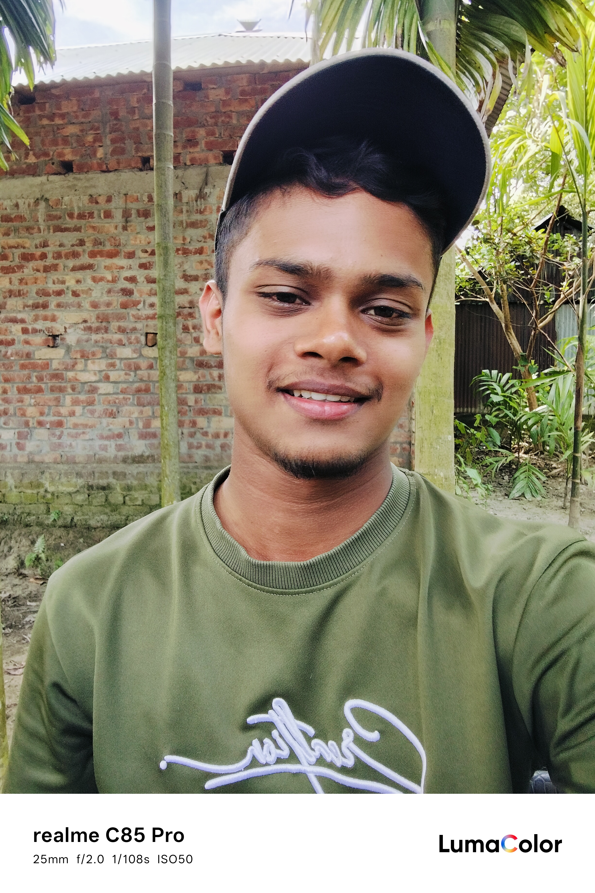

<div align="center">



# 📱 Zohir Mockup

**ফোনের ফ্রেমে ছবি ও ভিডিও বসিয়ে প্রমো ডিজাইন বানানোর ফ্রি ওপেন সোর্স টুল**


[🌐 লাইভ ডেমো](#-লাইভ-ডেমো) · [✨ ফিচার](#-ফিচার) · [🚀 চালানোর নিয়ম](#-গিটহাব-পেজেসে-চালানোর-নিয়ম) · [🤝 কন্ট্রিবিউট](#-কন্ট্রিবিউট-করতে-চাইলে) · [👤 ডেভেলপার](#-ডেভেলপার-পরিচিতি)

</div>

---

## 📖 পরিচিতি

**Zohir Mockup** হলো একটা সিঙ্গেল-ফাইল ওয়েব অ্যাপ। এতে যেকোনো অ্যাপের স্ক্রিনশট বা ভিডিও iPhone, Samsung বা Pixel ফ্রেমে বসিয়ে ফেসবুক, টিকটক, ইনস্টাগ্রাম আর ইউটিউবের জন্য প্রমো পোস্ট, স্টোরি ও রিলস বানানো যায়।

সবকিছু ব্রাউজারেই হয়, তাই **কোনো সার্ভার, লগইন বা ইনস্টলেশন লাগে না** এবং তোমার ছবি-ভিডিও কোথাও আপলোড হয় না।

## ✨ ফিচার

| | ফিচার | বিবরণ |
|---|---|---|
| 🖼️ | **ছবি ও ভিডিও** | ফোনের স্ক্রিনে ট্যাপ করে গ্যালারি থেকে ছবি বা ভিডিও বসানো যায় |
| 📱 | **৭টা ফোন মডেল** | iPhone 18/17/16/15/14 Pro Max, Galaxy S25 Ultra, Pixel 9 Pro |
| 🎨 | **৮টা টেমপ্লেট** | নোটিফিকেশন, স্টোরি টিল্ট, ডাবল স্ক্রিন, সাইড টেক্সট ও ৪টা ক্লাসিক সাইজ |
| ✍️ | **নিজের লেখা** | দুই লাইনের রঙিন হেডলাইন, ছোট লেখা, ওয়েবসাইট পিল ও ফুটার |
| 🌈 | **কাস্টমাইজ** | ফ্রেমের রং, অ্যাকসেন্ট রং ও ব্যাকগ্রাউন্ড গ্রেডিয়েন্ট |
| 📐 | **সোশ্যাল সাইজ** | ৯:১৬ (Reels, TikTok, Shorts), ৪:৫ (Facebook ফিড), ১:১, ১৬:৯ |
| 💾 | **হাই কোয়ালিটি সেভ** | ছবি ২x PNG, ভিডিও MP4 বা WebM, সাথে অডিও |
| ✅ | **কমপ্লিট ট্যাব** | সেভ করা সব ডিজাইন এক জায়গায় জমা হয়, আবার ডাউনলোড করা যায় |
| 👤 | **প্রোফাইল** | ব্র্যান্ড নাম, ওয়েবসাইট ও ফেসবুক লেখা একবার বসালে সব ডিজাইনে বসে যায় |
| 🌗 | **ডার্ক মোড** | ফোনের থিম অনুযায়ী নিজে থেকে বদলায় |

## 🌐 লাইভ ডেমো

> ডেপ্লয় করার পর লিংকটা এখানে বসিয়ে দাও:
> `https://তোমার-ইউজারনেম.github.io/রিপোজিটরির-নাম/`

## 🚀 গিটহাব পেজেসে চালানোর নিয়ম

1. এই রিপোজিটরি **Fork** করো অথবা ফাইলগুলো নিজের রিপোজিটরিতে আপলোড করো।
2. **Settings → Pages** এ যাও।
3. Source এ **Deploy from a branch** বেছে `main` ব্রাঞ্চ ও `/ (root)` সিলেক্ট করে **Save** করো।
4. ১-২ মিনিট পর লিংকে অ্যাপ চালু হয়ে যাবে।

নিজের কম্পিউটারে চালাতে চাইলে:

```bash
git clone https://github.com/তোমার-ইউজারনেম/রিপোজিটরির-নাম.git
cd রিপোজিটরির-নাম
# index.html ব্রাউজারে খুললেই হবে, আর কিছু লাগে না
```

## 🗂️ ফোল্ডার স্ট্রাকচার

```
📦 zohir-mockup
 ┣ 📄 index.html   # পুরো অ্যাপ (HTML + CSS + JavaScript)
 ┣ 🖼️ profile.jpg  # ডেভেলপারের ছবি
 ┣ 📄 README.md
 ┗ 📄 LICENSE
```

## 🛠️ ব্যবহৃত প্রযুক্তি

- **HTML5 Canvas** দিয়ে ডিজাইন আঁকা হয়
- **MediaRecorder API** ও **Web Audio API** দিয়ে ভিডিও রেকর্ড ও অডিও সেভ হয়
- **Vanilla JavaScript**, কোনো ফ্রেমওয়ার্ক বা লাইব্রেরি নেই
- বাংলা লেখার জন্য **Hind Siliguri** (Google Fonts)

## ⚠️ জানা দরকার

- ভিডিও সেভ করতে ভিডিওটা শুরু থেকে শেষ পর্যন্ত একবার চলে, তাই ১ মিনিটের ভিডিওতে প্রায় ১ মিনিটই লাগে। সেভ চলার সময় ট্যাব খোলা রাখতে হবে।
- ভিডিও সেভের জন্য **Google Chrome** সবচেয়ে ভালো কাজ করে।
- iPhone 18 Pro Max-এর ফ্রেম আনুমানিক মাপে বানানো।

## 🤝 কন্ট্রিবিউট করতে চাইলে

এই প্রজেক্ট সবার জন্য খোলা। নতুন ফোন মডেল, টেমপ্লেট বা বাগ ফিক্স যোগ করতে চাইলে:

1. রিপোজিটরি **Fork** করো
2. নতুন ব্রাঞ্চ বানাও: `git checkout -b feature/নতুন-ফিচার`
3. পরিবর্তন করে **Commit** করো
4. **Pull Request** পাঠাও

কোনো সমস্যা বা আইডিয়া থাকলে **Issues** ট্যাবে জানাও। ⭐ ভালো লাগলে একটা Star দিলে অনেক উৎসাহ পাবো।

## 👤 ডেভেলপার পরিচিতি

<div align="center">


### জাহিরুল ইসলাম (Zahirul Islam)

**ইন্ডিপেন্ডেন্ট ডেভেলপার ও কন্টেন্ট ক্রিয়েটর** · ব্র্যান্ড: **Zohir**

</div>

আমি ওয়েব ও মোবাইল অ্যাপ বানাই। এই প্রজেক্টের ডিজাইন, কোড ও আইডিয়া সবই আমার নিজের করা।
এছাড়া আমি একটা ফেসবুক পেজ চালাই, যেখানে বাংলা নাটক ও সিনেমার ক্লিপ দিয়ে থাকি।

| | |
|---|---|
| 🌐 **ওয়েবসাইট** | `https://wa.me/8801856591506` |
| 📘 **ফেসবুক পেজ** | `https://www.facebook.com/share/1Czn1vffAq/` |
| ✉️ **ইমেইল** | `jibonmahmud630@gmail.com` |
| 💻 **গিটহাব** | `github.com/zohir630` |

## 📜 লাইসেন্স

এই প্রজেক্ট **MIT লাইসেন্সের** আওতায় সম্পূর্ণ ওপেন সোর্স। তুমি এটা ব্যবহার, পরিবর্তন, শেয়ার এমনকি বাণিজ্যিক কাজেও লাগাতে পারো, শুধু মূল লেখকের কপিরাইট নোটিশটা রেখে দিও। বিস্তারিত [LICENSE](LICENSE) ফাইলে আছে।

---

<div align="center">

**❤️ বাংলাদেশ থেকে তৈরি · Made by [Zahirul Islam Zohir](#-ডেভেলপার-পরিচিতি)**

</div>
